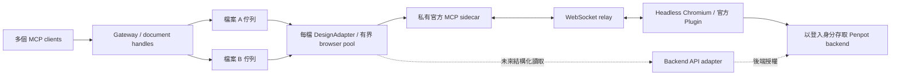

# 架構與診斷

## 排程與連線

- 正規化 file ID 是 worker 的索引；同檔不同頁面、team URL 或 UUID 大小寫共用佇列。每檔有獨立 adapter、browser、context、editor 與 MCP 路由 token。
- Pool 預設保留 2 個 browser。只回收閒置 worker，且須先確認儲存；回收獨立進行，不阻塞其他 slot 分配，也不超出等待需求。`hasResources` 區分「資源仍在」與「舊寫入結果未知」，避免已退出的 browser 繼續占容量。
- 每檔最多 32、全域最多 128 個接受中的操作，以及 128 個 handles；額度包含開檔中的預留。文件查詢使用不配置 browser 的獨立 adapter。操作指引與限制見 [README](../README.md) 及 [Agent 指引](agent-guide.md)。
- Playwright 只改送指定站點的 `/mcp/ws`，其餘協作 WebSocket 與後端請求維持 Penpot 原有登入行為。每檔 HTTP client 與 Plugin 使用同一個隨機路由 token，避免替換其他檔案的連線。
- 官方 sidecar 的 token 用於連線配對，不是使用者授權；sidecar 不公開 HTTP／WebSocket ports。Gateway 的授權邊界是 stdio process 或 bearer token，一組 Gateway 為同一可信任身分，handle 不是額外權限邊界。

## 儲存、頁面與回收

`execute_code` 把檔案／頁面檢查放在同一次腳本派送，不增加暖路徑 RPC；匯出另行檢查。`open_page` 與交替使用既有頁面 handles 透過 Plugin 切頁，保留 editor。程式自行導航後，下一次錯誤 target 的腳本會在執行前被拒絕。

預設 `save=wait` 等待 saved 指示穩定 750 ms，並確認沒有未完成或失敗的 `update-file` 請求，避免讀到 debounce 前的舊 saved 狀態。`deferred` 回傳 `_meta.saveState=not_confirmed`，由批次末端 flush 確認；成功 barrier 可沿用，直到下一次執行或儲存請求使它失效。這不是跨系統交易保證。

正常切頁、close 與回收都先確認儲存。活躍 editor 儲存未確認時保留資源；已遺失的 editor 則釋放資源並仍回 `SAVE_UNCONFIRMED`。未確認工作遭 browser／page 遺失或逾時時，檔案 epoch 前進，舊 handles 禁止執行與 flush；inspect 標記 unknown，新 handle 供讀回核對，但不清除舊 handle 的未知狀態。派送過的程式碼不自動重送，逾時會先終止原 browser，避免延遲腳本繼續修改。

初始化／導航失敗回收不完整資源；handle 資料於開檔失敗、明確關閉與 shutdown 釋放。閒置回收失敗會在下一個閒置週期重檢。關機由 Gateway 統一處理訊號，停用 Playwright 的提前關閉行為；排空已接受工作與儲存後才關傳輸，失敗保留恢復入口，每 5 秒重試。正常退出等待輸出完成，Compose 關機等待預設 5 分鐘。

官方 Plugin 會把執行結果寫入 Chromium console；每次收到結果後用 `Runtime.discardConsoleEntries` 釋放 inspector 參照，保留 MCP 回傳日誌與 Plugin storage，正常運行不強制 GC。HTTP 沒有持久化 client session，handles 只存在於目前 Gateway process。

## 診斷紀錄

預設每次操作在 stderr 輸出一行 JSON，stdio stdout 保留給 MCP；`PENPOT_DIAGNOSTICS=false` 停用一般紀錄。Compose 使用 Docker `local` driver，單檔 10 MB、最多 3 檔；原生程序的輪替由啟動端管理。紀錄不含 URL、文件／頁面 ID、handle、程式碼、結果內容、帳號或憑證。

| `event=request` 欄位 | 意義 |
|---|---|
| `requestId`、`workerId` | 隨機請求／worker 識別碼，用於關聯操作，非文件 ID |
| `operation`、`outcome`、`errorCode` | 操作、結果、安全錯誤類別；不記錄原始例外 |
| `queueMs`、`queuedAhead` | 同檔佇列的等待時間與抵達時待完成數量 |
| `workerWaitMs` | 等待 browser pool 容量／回收 |
| `activationMs` | 初始化與切頁，扣除其中的上游、儲存與清理 |
| `upstreamMs`、`upstreamCalls` | MCP 往返時間／次數，包含序列化、網路與 Plugin 執行 |
| `saveMs`、`cleanupMs` | 儲存等待、資源清理；清理時間不重複計入儲存 |
| `totalMs` | 含排隊的總時間，不含前端 HTTP 傳輸或 Agent 思考時間 |
| `responseContentBytes` | content 文字／base64 的 UTF-8 大小，不是完整網路流量 |
| `connectionProbeRetries` | 唯讀連線探測重試數，不是寫入重試 |

各階段不重複計時。`BUSY` 在排隊前記錄拒絕；HTTP 授權／schema 錯誤不在 Gateway 操作紀錄內。`browser_started`、`editor_ready`、`page_selected`、`editor_lost`、`browser_closed` 記錄生命週期與 Node RSS（不含 Chromium）。回收操作分為 `idle_reclaim`／`worker_eviction`；只有非預期中斷標記 editor 遺失。

關機失敗固定輸出 `shutdown_failed`、`errorCode`、`retryMs`，即使一般紀錄停用也保留。暖機讀取／大型回覆的紀錄開關對照由 `test:diagnostics` 量測；結果見 [效能摘要](performance.md)。

## 授權與方案 C

終端登入只保存 mode 0600 的 Playwright storageState；這是憑證，不放入 Git、映像或日誌。Session 取得與更新目前不含 SSO/MFA。任意 JavaScript 屬使用者授權的可信任操作，沒有對同一身分提供沙箱隔離；分享連結不能經 editor 路徑升級權限。

`DesignAdapter` 封裝開檔、執行、儲存、匯出與回收，不暴露 Playwright 型別。方案 C 可加入結構化後端 read adapter，由 router 選擇 API 或 editor；需要獨立後端授權、版本化資料格式、revision cache、寫入後失效處理與權限重驗。多使用者服務另需 principal-to-worker 對應、session 隔離與配額，不能把目前的 bearer token 當成身分聯邦。

官方參考：[MCP 架構](https://github.com/penpot/penpot/tree/develop/mcp)、[連接說明](https://help.penpot.app/mcp/)、[token 配對](https://github.com/penpot/penpot/blob/1a80e98e623f962fe91c9971a5c2bc8617677a4b/mcp/packages/server/src/McpAuthentication.ts)、[儲存 debounce](https://github.com/penpot/penpot/blob/2.18.6/frontend/src/app/main/data/persistence.cljs)。Toolbar、socket 路徑與儲存指示器是版本相依處，升級後需重跑 [測試指南](testing.md) 的真實驗收。
