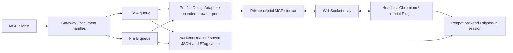

# Architecture and diagnostics

**English** | [繁體中文](architecture.zh-TW.md) | [README](../README.md)

## Scheduling and connections

- Workers are keyed by normalized file ID. Pages, team URL variants, and UUID casing for one file share a queue. Each file has its own adapter, browser, context, editor, and MCP routing token.
- The pool defaults to two browsers and reclaims only idle workers after confirming saves. There are at most 32 accepted operations per file, 128 globally, and 128 handles, including reservations during opening. API documentation and `read_document` requests do not allocate a browser. Saved reads use the same file queue and flush pending writes; they do not consume a new browser slot.
- Playwright reroutes only the configured site's `/mcp/ws`. Collaboration sockets and backend requests keep Penpot's original authentication. Each file's HTTP client and plugin use the same random routing token.
- Sidecar tokens pair connections; they do not authorize users. Sidecar ports remain private. A gateway's bearer token or stdio process represents one trusted identity; document handles do not add an authorization boundary.

## Saving and recovery

`execute_code` checks file/page identity in the script dispatch, avoiding an extra warm-path RPC; exports check separately. Page handles switch through the Plugin and reuse the editor. If a script navigates away, the next mismatched script is rejected before execution.

Default `save=wait` requires a stable saved indicator for 750 ms and no pending or failed `update-file` requests. `deferred` returns `_meta.saveState=not_confirmed`; finish write batches with `flush_document`. A confirmed save barrier is reused until another execution or save request invalidates it.

Page changes, close, and reclamation confirm saves first. Unconfirmed saves retain a live editor; a lost editor releases resources but still reports `SAVE_UNCONFIRMED`. Browser/page loss or timeout during unconfirmed work invalidates old handles for execution and flush. Fresh handles allow readback without resolving the old write's uncertainty. Dispatched code is never automatically replayed; a timeout terminates the old browser to prevent late edits.

Initialization failures release incomplete resources; failed idle reclamation retries on the next idle cycle. Shutdown drains accepted work and saves before closing transports. Failure keeps the recovery endpoint available and retries every 5 seconds; Compose allows 5 minutes before a forced stop. Handles exist only in the gateway process and expire on restart.

The adapter clears inspector references with `Runtime.discardConsoleEntries` after plugin results, preserving MCP logs and Plugin storage without forcing GC. See [performance](performance.md) for the measured effect and the [agent guide](agent-guide.md) for recovery steps.

## Diagnostic logs

Each operation emits a JSON line to stderr; stdio stdout is reserved for MCP. `PENPOT_DIAGNOSTICS=false` disables routine logs. Compose rotates Docker `local` logs at 10 MB, retaining up to 3 files; native processes need host-managed rotation. Logs omit URLs, file/page IDs, handles, code, result contents, accounts, and credentials.

| `event=request` field | Meaning |
|---|---|
| `requestId`, `workerId` | Random correlation IDs, not document IDs |
| `operation`, `outcome`, `errorCode` | Operation, result, and safe error category; no raw exceptions |
| `queueMs`, `queuedAhead` | Same-file queue wait and pending work on arrival |
| `workerWaitMs` | Waiting for browser capacity or reclamation |
| `activationMs` | Initialization/page switching, excluding nested upstream, save, and cleanup time |
| `upstreamMs`, `upstreamCalls` | MCP round-trip time/count, including serialization, network, and Plugin execution |
| `backendMs`, `backendCalls`, `cacheRevalidations` | Saved-file HTTP/decode time, request count and validated 304 hits |
| `saveMs`, `cleanupMs` | Save confirmation and resource cleanup, without double-counting cleanup |
| `totalMs` | Includes queue time; excludes frontend HTTP transport and agent thinking |
| `responseContentBytes` | UTF-8 size of content text/base64, not total wire size |
| `connectionProbeRetries` | Read-only connection probes, not write retries |

Phases do not double-count time. `BUSY` is logged before queue admission; HTTP authentication/schema failures are outside these operation logs. Lifecycle events (`browser_started`, `editor_ready`, `page_selected`, `editor_lost`, `browser_closed`) include Node RSS, excluding Chromium. `idle_reclaim` and `worker_eviction` identify reclamation; only unexpected losses emit `editor_lost`.

Shutdown failures always log `shutdown_failed`, `errorCode`, and `retryMs`, even with routine logging disabled. `test:diagnostics` measures logging overhead.

## Authorization and future extensions

Login saves only Playwright storageState with file mode `0600`, excluded from Git, images, and logs. Automatic SSO/MFA session renewal is not implemented. JavaScript execution is trusted code under one account, without tenant isolation; viewer links cannot gain editor permissions through the gateway.

`DesignAdapter` exposes open, execute, save, export, and reclamation without Playwright types. `BackendReader` uses scoped session cookies, fixed-origin HTTP requests, and permission-aware ETag validation on every read. It retains at most four serialized files / 32 MiB, with at most two concurrent reads and no stale fallback. The [browserless read guide](browserless-reads.md) explains data and compatibility boundaries. Multiple users additionally require identity-to-worker mapping, isolated sessions, and quotas.

Upstream references: [MCP architecture](https://github.com/penpot/penpot/tree/develop/mcp), [connection setup](https://help.penpot.app/mcp/), [token pairing](https://github.com/penpot/penpot/blob/1a80e98e623f962fe91c9971a5c2bc8617677a4b/mcp/packages/server/src/McpAuthentication.ts), [save debounce](https://github.com/penpot/penpot/blob/2.18.6/frontend/src/app/main/data/persistence.cljs). Toolbar controls, socket paths, and save indicators are version-sensitive; run [real-instance acceptance](testing.md) after upgrades.
