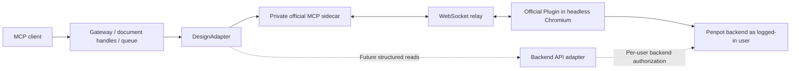

# Architecture

## Current adapter

Each process has one authenticated browser context and at most one active editor page. Handles refer to a configured origin, file and optional page. Opening, switching, editing and closing run through one bounded queue. Changing documents closes the previous page after checking the save indicator. Idle browsers are reclaimed; handles can reopen their documents.

The browser loads the real Penpot application and its bundled MCP Plugin. Playwright routes only the configured site's `/mcp/ws` socket to a dedicated official MCP server. The relay uses a random in-memory routing token, shared with this process's upstream HTTP client. The user's original MCP token is not forwarded to the sidecar. Collaboration sockets and backend calls retain their normal authenticated Penpot behavior.

This relies on the current official MCP server using tokens for connection matching. It is a private sidecar, not an authorization service: never expose its HTTP or WebSocket ports publicly. The public gateway boundary is stdio process ownership or the gateway bearer token. One gateway is one trusted principal; a guessed document handle is not a separate permission boundary.

Authentication uses an interactive terminal with masked password entry and the Penpot password-login endpoint. Only Playwright storageState is persisted, with mode 0600. Session files are credentials. They are not logged, committed or copied into images. SSO/MFA session acquisition and refresh are not implemented.

The adapter verifies file/page identity before dispatch. Warm `execute_code` calls use the identity guard in the same dispatched script, removing a redundant round trip. Exports still verify context separately. Penpot remains responsible for user/file permissions. Share-link access must use a future restricted read adapter; it is deliberately rejected in the editor path. Local browser JavaScript, especially arbitrary `execute_code`, is trusted as a user-authorized operation rather than sandboxed against that same user.

## Recovery and persistence

- The adapter does not retry dispatched code. Lost responses cause browser teardown and `EXECUTION_UNKNOWN`.
- Official sidecar task timeouts can arrive inside a normal JSON-RPC tool response. They also cause teardown and `EXECUTION_UNKNOWN`; the queue advances only after the old browser has exited, so its code cannot continue behind subsequent calls.
- The default `save=wait` requires editor saved status to remain stable for 750 ms after execution, including a returned tool error, with no unfinished or failed `update-file` request. This exceeds the released editor's 200 ms pending-status debounce; checking once can observe the previous saved state and discard a fresh edit when switching files. This remains a version-sensitive integration, not an atomic commit guarantee.
- `save=deferred` returns execution acknowledgment immediately, with `_meta.saveState=not_confirmed`. A serialized `flush_document` waits for persistence after the batch. This mode also avoids unnecessary persistence waits on reads; it is not a read-only sandbox. Both modes retain the same identity guard and queue.
- A successful barrier is reused until another execution/save request invalidates it. Normal close does not add another fixed wait after an already confirmed write.
- Normal close and idle reclamation also await saving. An unconfirmed save retains a live editor. An already lost editor is reclaimed while close still reports `SAVE_UNCONFIRMED`; old handles retain their uncertain status. A transport timeout forcibly closes the browser to stop code with an unknown execution state; a failed script may have partially edited the file.
- Reopening and reading back a known object is the acceptance check for persistence.
- Browser session expiry requires a new login. MCP connection polling retries only the fixed read-only identity query. Toolbar UI may remount while loading; actual plugin identity determines readiness. Previous page relay sockets are retired before connecting the next file.
- Browser/context initialization publishes resources only after setup succeeds. Failed context or relay setup closes the new browser; failed page navigation or plugin setup tears down the incomplete editor, allowing the next open to retry normally.
- Save observation belongs to one editor instance. Browser/page loss with unconfirmed work advances the file's epoch. Existing handles for that file retain the old epoch and cannot execute or flush; inspection reports `saveState=unknown`. A fresh `open_document` binds to the current epoch for readback and reconciliation, without rehabilitating old handles. Other files retain their handles. These local checks add no upstream requests to warm execution.
- Handle bookkeeping is released on failed opens, explicit close and gateway shutdown. File epochs are retained only while handles or the active editor reference them.
- Plain-text official tool failures are normalized to MCP `isError=true` without changing successful user results.
- The official plugin logs result objects to Chromium's console. After receiving a tool result, the adapter drops inspector console references to avoid retaining large object graphs. It does not clear plugin storage or returned MCP logs, and does not force garbage collection in normal operation.
- The HTTP transport has no durable per-client MCP session; document handles live in this single gateway process and expire on restart.

## Extension to scheme C

`DesignAdapter` in `src/adapter.ts` owns `open`, `execute`, `flush`, `exportShape`, documentation, handle release and close operations, without exporting Playwright types. `release(target)` discards handle bookkeeping after its target is no longer reachable through the gateway; it does not flush or close an editor. Introduce a separate backend read adapter for normalized document/page/shape queries and a router deciding which operation needs an editor. Do not expose arbitrary backend RPC or database writes as a shortcut.

For the hybrid phase, add explicit read operations, backend credentials separate from MCP routing tokens, versioned response normalization, revision-aware cache keys, permission revalidation and invalidation after browser writes. Keep full Plugin execution and rendering in the existing adapter until backend equivalents are verified.

Multi-user hosting also needs authenticated principal-to-worker mapping, isolated session storage, quotas and independent queues. The current bearer token must not be treated as an identity federation mechanism.

## Upstream reference

- [Official MCP architecture](https://github.com/penpot/penpot/tree/develop/mcp)
- [MCP connection and token behavior](https://github.com/penpot/penpot/blob/1a80e98e623f962fe91c9971a5c2bc8617677a4b/mcp/packages/server/src/McpAuthentication.ts)
- [Official connection instructions](https://help.penpot.app/mcp/)
- [Released persistence pipeline and debounce](https://github.com/penpot/penpot/blob/2.18.6/frontend/src/app/main/data/persistence.cljs)

The browser toolbar and socket path are version integration points. The tested released runtime uses hash workspace URLs; alternate query links normalize to that route. The newer develop management API is not required by this implementation.
