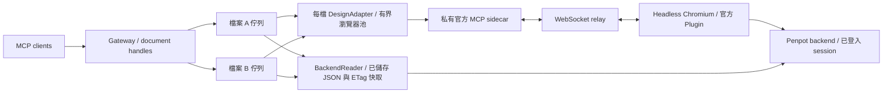

# 架構與診斷

[English](architecture.md) | **繁體中文** | [README](../README.zh-TW.md)

## 排程與連線

- Worker 以正規化 file ID 索引；同檔不同頁面、team URL 或 UUID 大小寫共用佇列。每檔有獨立 adapter、browser、context、editor 與 MCP 路由 token。
- 瀏覽器池預設容量為兩個，只在確認儲存後回收閒置 worker。接受中的操作上限為每檔 32、全域 128，handles 上限為 128，包含開檔中的預留額度。API 文件查詢與 `read_document` 不配置瀏覽器。後端讀取沿用同檔佇列並確認先前寫入已儲存，不佔用新的瀏覽器名額。
- Playwright 只改送指定站點的 `/mcp/ws`，協作 WebSocket 與後端請求維持 Penpot 原有認證。每檔 HTTP client 與 Plugin 使用相同的隨機路由 token。
- Sidecar token 用於連線配對，不代表使用者授權；其 ports 不對外公開。Gateway 的 bearer token 或 stdio process 代表同一可信任身分，handle 不提供額外授權邊界。

## 儲存與恢復

`execute_code` 在同一次腳本派送內檢查檔案／頁面，不增加暖路徑 RPC；匯出另行檢查。頁面 handles 透過 Plugin 切頁並沿用編輯器。腳本若自行導航，下次目標不符的腳本會在執行前被拒絕。

預設 `save=wait` 要求 saved 指示穩定 750 ms，且沒有未完成或失敗的 `update-file` 請求。`deferred` 回傳 `_meta.saveState=not_confirmed`，寫入批次結束時須 `flush_document`。已確認的儲存狀態可沿用，直到下次執行或儲存請求使其失效。

切頁、close 與回收會先確認儲存。儲存未確認時保留仍存活的編輯器；已遺失的編輯器則釋放資源，仍回報 `SAVE_UNCONFIRMED`。未確認工作遇到 browser／page 遺失或逾時，舊 handles 禁止執行與 flush；新 handle 可讀回，但不解除舊寫入的未知狀態。已派送的程式碼不自動重送，逾時會終止原瀏覽器，避免延遲修改。

初始化失敗會釋放不完整資源；閒置回收失敗會在下個週期重試。關機先完成已接受工作與儲存，再關閉傳輸；失敗時保留恢復入口，每 5 秒重試，Compose 最多等待 5 分鐘後強制停止。Handles 只存在於目前 Gateway process，重啟後失效。

Adapter 在 Plugin 回傳後用 `Runtime.discardConsoleEntries` 清除 inspector 參照，保留 MCP 日誌與 Plugin storage，不強制 GC。量測方式見[效能摘要](performance.zh-TW.md)，恢復步驟見 [Agent 指引](agent-guide.zh-TW.md)。

## 診斷紀錄

每次操作在 stderr 輸出一行 JSON，stdio stdout 留給 MCP。`PENPOT_DIAGNOSTICS=false` 停用一般紀錄。Compose 使用 Docker `local` 輪替，單檔 10 MB、最多 3 檔；原生程序由主機管理輪替。紀錄不含 URL、文件／頁面 ID、handle、程式碼、結果內容、帳號或憑證。

| `event=request` 欄位 | 意義 |
|---|---|
| `requestId`, `workerId` | 隨機關聯 ID，不是文件 ID |
| `operation`, `outcome`, `errorCode` | 操作、結果與安全錯誤類別，不記錄原始例外 |
| `queueMs`, `queuedAhead` | 同檔佇列等待時間與抵達時待完成數量 |
| `workerWaitMs` | 等待瀏覽器容量或回收 |
| `activationMs` | 初始化／切頁，扣除其內部上游、儲存與清理時間 |
| `upstreamMs`, `upstreamCalls` | MCP 往返時間／次數，含序列化、網路與 Plugin 執行 |
| `backendMs`, `backendCalls`, `cacheRevalidations` | 後端 HTTP／解碼時間、請求數與驗證成功的 304 次數 |
| `saveMs`, `cleanupMs` | 儲存確認與資源清理，不重複計算清理時間 |
| `totalMs` | 包含排隊，不含前端 HTTP 傳輸或 Agent 思考時間 |
| `responseContentBytes` | content 文字／base64 的 UTF-8 大小，不是完整傳輸大小 |
| `connectionProbeRetries` | 唯讀連線探測次數，不是寫入重試 |

各階段不重複計時。`BUSY` 在進佇列前記錄；HTTP 認證／schema 錯誤不屬於這些操作紀錄。生命週期事件（`browser_started`、`editor_ready`、`page_selected`、`editor_lost`、`browser_closed`）包含 Node RSS，不含 Chromium。回收以 `idle_reclaim`／`worker_eviction` 區分，只有非預期遺失才記錄 `editor_lost`。

即使停用一般紀錄，關機失敗仍輸出 `shutdown_failed`、`errorCode` 與 `retryMs`。`test:diagnostics` 用來量測紀錄開銷。

## 授權與後續擴充

登入只保存權限為 `0600` 的 Playwright storageState，不放入 Git、映像或日誌；尚未實作 SSO/MFA 自動更新。JavaScript 是同一帳號下的可信任程式碼，沒有多租戶隔離；viewer 連結不能透過 Gateway 取得編輯權限。

`DesignAdapter` 封裝開檔、執行、儲存、匯出與回收，不暴露 Playwright 型別。`BackendReader` 使用符合站點範圍的 session cookies、固定 origin 的 HTTP 請求，每次讀取都以含權限狀態的 ETag 重新驗證。最多快取四份序列化檔案／32 MiB，同時最多兩筆讀取；失敗時不回傳舊快取。[無瀏覽器讀取指南](browserless-reads.zh-TW.md) 說明資料與相容性邊界。支援多使用者還需要身分與 worker 對應、session 隔離及配額。

官方參考：[MCP 架構](https://github.com/penpot/penpot/tree/develop/mcp)、[連接說明](https://help.penpot.app/mcp/)、[token 配對](https://github.com/penpot/penpot/blob/1a80e98e623f962fe91c9971a5c2bc8617677a4b/mcp/packages/server/src/McpAuthentication.ts)、[儲存 debounce](https://github.com/penpot/penpot/blob/2.18.6/frontend/src/app/main/data/persistence.cljs)。Toolbar、socket 路徑與儲存指示器會隨版本變動，升級後請重跑[真實環境驗收](testing.zh-TW.md)。
